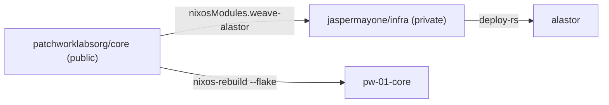

# core

NixOS configuration for Patchwork Labs hosts, and the NixOS modules for Patchwork services.

## Layout

| Path | Contents |
|---|---|
| `flake.nix` | Flake outputs. |
| `hosts/pw-01-core/` | The `pw-01-core` VM. |
| `hosts/alastor/weave.nix` | Weave as it runs on alastor. Exported as `nixosModules.weave-alastor`. |
| `modules/weave/` | The Weave service module. Exported as `nixosModules.weave`. |
| `secrets/` | agenix secrets. `secrets.nix` lists the recipients of each file. |

## How this repo connects to `jaspermayone/infra`

This repo is public. `jaspermayone/infra` is private. The dependency goes in one direction only: `infra` uses this repo as the flake input `patchwork-core`. This repo never uses `infra`, so every org admin can build it.



alastor is Jasper's VPS. It runs Weave and its Traefik edge. `infra` owns the host. This repo owns everything about Weave on it: the module, the instance settings, the CI deploy key, the Traefik routes and the secrets.

To change Weave on alastor:

1. Merge the change here.
2. In `infra`, run `nix flake update patchwork-core`.
3. Deploy alastor from `infra` (`deploy .#alastor`).

alastor also rebuilds itself at 04:00 from `infra`'s `main`. It uses the `patchwork-core` revision in `infra`'s `flake.lock`, so a merge here does nothing on alastor until step 2.

## Commands

```bash
nix flake check
nix fmt
nixos-rebuild switch --flake .#pw-01-core --target-host root@pw-01-core
cd secrets && agenix -e <name>.age   # create or edit a secret
cd secrets && agenix -r              # re-key after changing recipients
```

## Access

All accounts use SSH keys only. Password login is off. Members of `wheel` use `sudo` without a password.
